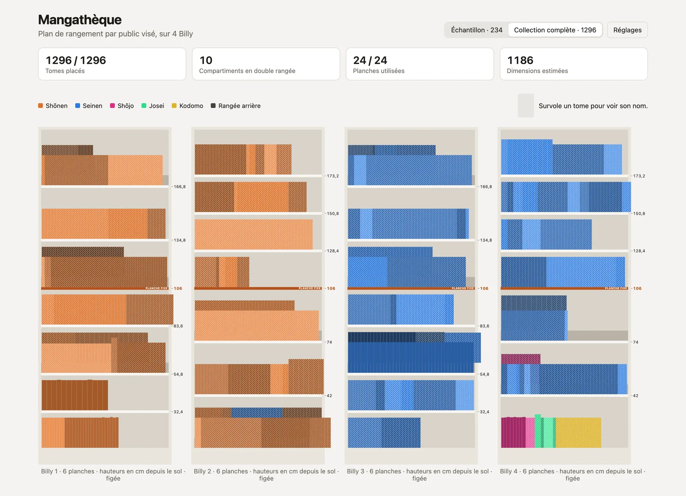
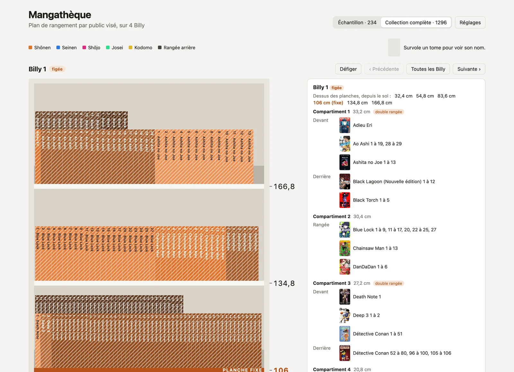

# Mangathèque

[](https://github.com/Kocal/mangatheque/actions/workflows/ci.yml)

Plan de rangement de ma collection de mangas, près de 1300 tomes, dans 4 bibliothèques IKEA Billy. L'appli calcule où mettre chaque tome et à quelle hauteur poser chaque planche, puis dessine le résultat à l'échelle, comme si on était devant les étagères.





## Ce que fait l'appli

- Range par public visé (Shōnen, Seinen, Shōjo, Josei, Kodomo), puis par ordre alphabétique. Les séries d'un même univers (GTO, Naruto…) restent côte à côte.
- Ne coupe jamais une série entre deux compartiments. Une série trop longue pour une rangée continue dans la rangée arrière, surélevée par une marche.
- Cherche d'abord le moins de doubles rangées possible, puis des planches à la même hauteur d'une Billy à l'autre.
- Donne la hauteur de chaque planche depuis le sol, calée sur les trous de taquets.
- Fige une Billy déjà rangée : son contenu ne bouge plus, et le plan ne change plus que dans les autres.

## Démarrer

Il faut [Vite+](https://viteplus.dev/guide/) (`vp`) et Node.js 24.

```sh
vp install
vp dev
```

## Mettre à jour les données

Les données sont versionnées dans `data/` et lues par l'appli au chargement.

1. Collection, depuis Manga Collec : connecte-toi sur Manga Collec, ouvre DevTools, onglet Réseau, fais "Copy response" sur la requête `users/me/collection`, puis lance la commande ci-dessous. La page publique de Manga Collec est souvent en retard, d'où la réponse de la version connectée.
   ```sh
   pbpaste | vp run import:collection
   ```
2. Dimensions, depuis Amazon : les résultats sont gardés dans `data/dimensions.json`. Amazon affiche un captcha après une centaine de pages : relance plus tard, rien n'est perdu. Un tome sans dimensions est estimé (1,8 cm d'épaisseur par défaut) et hachuré dans l'appli.
   ```sh
   vp run fetch:dimensions --one-per-edition
   ```
3. Mesures prises à la main : `src/data/measures.ts`. Elles passent devant Amazon et les estimations.
4. Univers : `src/data/universes.ts`.
5. Billy figées : bouton "Figer cette Billy" dans l'appli. `vp dev` écrit le résultat dans `data/frozen.json`.

## Développement

```sh
vp check      # format, lint, types
vp test
vp run build
```

Les règles de rangement et les décisions prises en chemin sont dans [la spec](docs/superpowers/specs/2026-10-16-mangatheque-poc-design.md).
